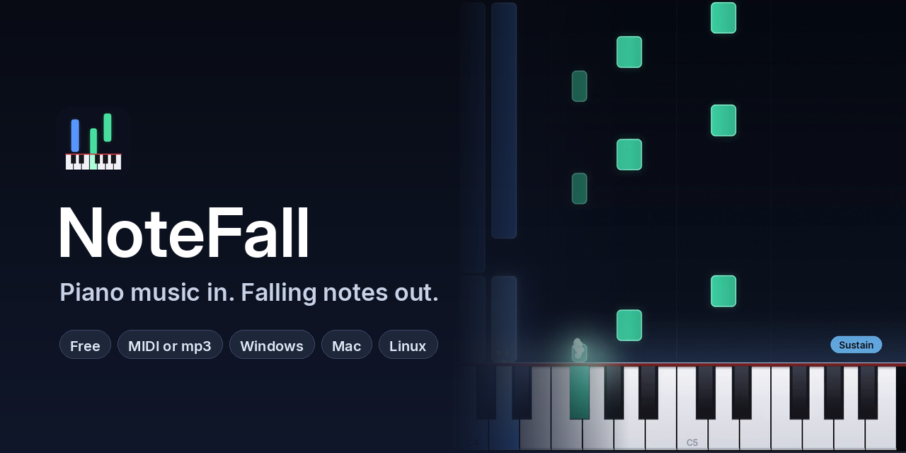
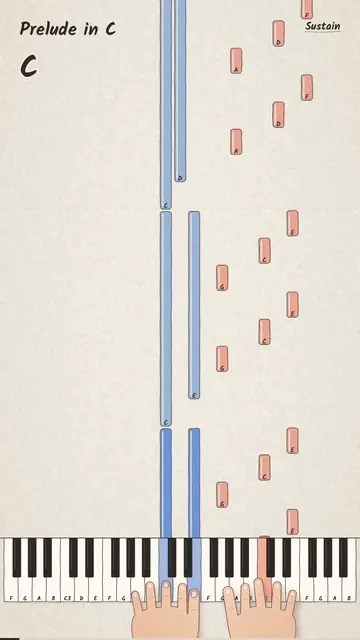
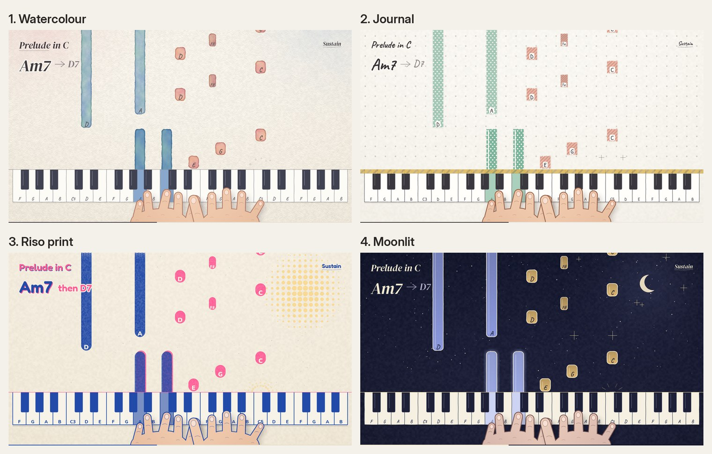
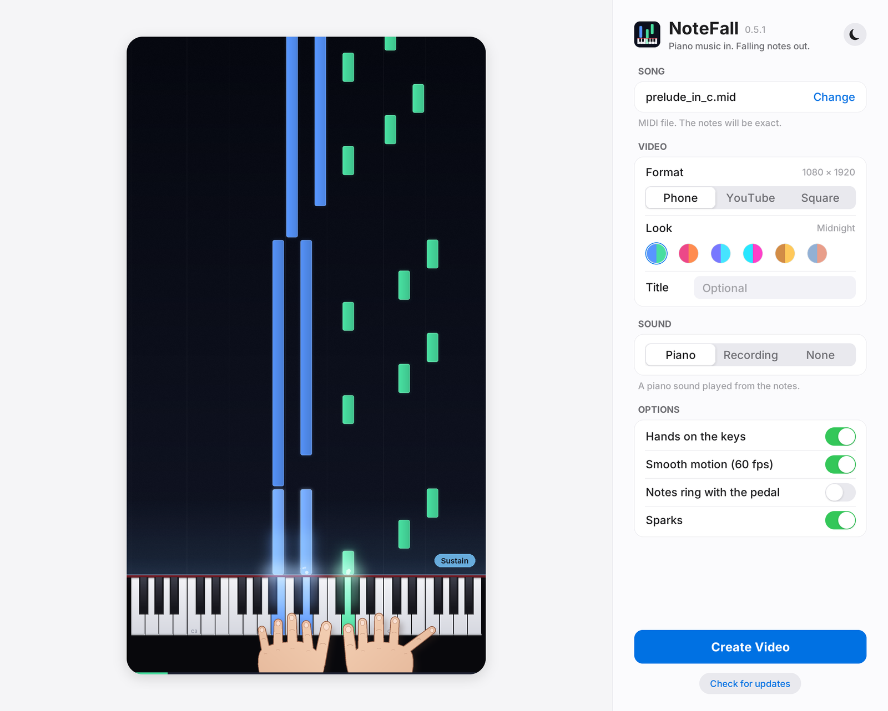

<p align="center">
  
</p>

<p align="center">
  <b>Turn piano music into a falling notes video.</b><br>
  Give it a MIDI file or just a recording of someone playing. Get a video back, ready to post.
</p>

<p align="center">
  <a href="https://github.com/Suma-Udd/notefall/releases/latest"></a>
  <a href="https://github.com/Suma-Udd/notefall/releases"></a>
  
  <a href="https://github.com/Suma-Udd/notefall/actions/workflows/tests.yml"></a>
  <a href="LICENSE"></a>
</p>

<p align="center">
  <a href="https://github.com/Suma-Udd/notefall/releases/latest"></a>
  <a href="https://github.com/Suma-Udd/notefall/releases/latest"></a>
  <a href="https://github.com/Suma-Udd/notefall/releases/latest"></a>
</p>

<p align="center">
  <sub>Free, no account, no watermark. Everything runs on your own computer.</sub>
</p>

<br>

## See it

<table>
  <tr>
    <td align="center">
      <br>
      <sub><b>Midnight</b> look. Watch with sound: <a href="docs/media/demo-landscape.mp4">YouTube shape</a> · <a href="docs/media/demo.mp4">phone shape</a></sub>
    </td>
    <td align="center">
      <br>
      <sub><b>Paper</b> look. <a href="docs/media/demo-paper.mp4">With sound</a></sub>
    </td>
  </tr>
</table>

<p align="center"><sub>Bach's Prelude in C, straight out of NoteFall. Nothing edited by hand.</sub></p>

<p align="center">
  <br>
  <sub>The newer hand made looks: <b>Watercolour</b>, <b>Journal</b>, <b>Riso print</b> and <b>Moonlit</b>.</sub>
</p>

## What it does

<table>
  <tr>
    <td width="50%" valign="top">
      <h3>🎹 MIDI in, video out</h3>
      Every note lands on the exact key, left hand in one colour, right hand in another.
    </td>
    <td width="50%" valign="top">
      <h3>🎧 No MIDI? Use a recording</h3>
      An mp3, a phone recording or a video of someone playing. NoteFall listens with a piano only model, writes down the notes and the pedal, and keeps the real sound. You can save what it heard as a MIDI too.
    </td>
  </tr>
  <tr>
    <td valign="top">
      <h3>📱 Ready to post</h3>
      Phone (TikTok, Reels, Shorts), YouTube or square, in smooth 60 fps.
    </td>
    <td valign="top">
      <h3>✋ Hands that play</h3>
      Two animated hands glide over the keys and press each note on the beat. Every look has them.
    </td>
  </tr>
  <tr>
    <td valign="top">
      <h3>🎨 Ten looks</h3>
      Five hand made pages (<b>Paper</b>, <b>Watercolour</b>, <b>Journal</b>, <b>Riso print</b> and <b>Moonlit</b>) with every key and note named and the chord on screen, or glowing notes on a dark stage in five colour sets. Pick one from the little pictures in the app.
    </td>
    <td valign="top">
      <h3>🔄 Updates itself</h3>
      Click <b>Check for updates</b> in the app. On Windows it downloads, installs and reopens in one go.
    </td>
  </tr>
</table>

## The app

<p align="center">
  <picture>
    <source media="(prefers-color-scheme: dark)" srcset="docs/media/app-dark.png">
    
  </picture>
</p>

<p align="center"><sub>Light and dark mode. It follows your computer, and the button in the corner switches it.</sub></p>

## Get it

<table>
  <tr>
    <th width="33%">🪟 Windows</th>
    <th width="33%">🍎 Mac</th>
    <th width="33%">🐧 Linux</th>
  </tr>
  <tr>
    <td valign="top">
      1. Download the <b>Setup.exe</b><br>
      2. Open it and click <b>Install</b><br>
      3. Find NoteFall in the Start menu<br>
      <br>
      No admin password needed.
    </td>
    <td valign="top">
      1. Download the <b>mac-arm64.dmg</b><br>
      2. Open it and drag NoteFall onto <b>Applications</b><br>
      <br>
      Older Intel Mac? Take the <b>mac-x64.dmg</b> instead. Not sure? Apple menu → <b>About This Mac</b>.
    </td>
    <td valign="top">
      1. Download the <b>linux-x64.tar.gz</b><br>
      2. Unpack it and open <b>NoteFall</b> inside the folder<br>
      <br>
      Or use the one line installer below.
    </td>
  </tr>
</table>

<p align="center">
  All the files are on the <b><a href="https://github.com/Suma-Udd/notefall/releases/latest">download page</a></b>, under <b>Assets</b>.
</p>

### Good to know

<details>
<summary><b>My computer says the app might be unsafe</b></summary>
<br>

That's because the app isn't signed by a big company (signing costs money every year). It's the same app, built in the open right here by GitHub.

- **Windows:** click **More info**, then **Run anyway**.
- **Mac:** open NoteFall once, then go to **System Settings → Privacy & Security** and click **Open Anyway**.

You only do this once.

</details>

<details>
<summary><b>How do updates work?</b></summary>
<br>

NoteFall checks for a new version when it opens, and you can check any time with the **Check for updates** button under **Create Video**. On Windows one click downloads the new version, installs it and reopens the app. On Mac and Linux it opens the download page.

On 0.3.0 or older, download the new version by hand once. After that it's automatic.

</details>

<details>
<summary><b>Prefer a one line installer?</b></summary>
<br>

It installs NoteFall with a shortcut, needs no admin password, and you can run it again any time to update.

**Windows:** open **PowerShell**, paste this and press Enter:

```powershell
powershell -ExecutionPolicy ByPass -c "irm https://raw.githubusercontent.com/Suma-Udd/notefall/main/scripts/install.ps1 | iex"
```

**Mac or Linux:** open **Terminal**, paste this and press Enter:

```sh
curl -LsSf https://raw.githubusercontent.com/Suma-Udd/notefall/main/scripts/install.sh | sh
```

</details>

## Make a video

<table>
  <tr>
    <td width="25%" valign="top">
      <h3>🎵 Pick a song</h3>
      Click <b>Choose…</b> and pick a MIDI or a recording. To try it, use <a href="examples/prelude_in_c.mid">prelude_in_c.mid</a>.
    </td>
    <td width="25%" valign="top">
      <h3>🎨 Make it yours</h3>
      Pick a format and a look. The preview plays along as you change things.
    </td>
    <td width="25%" valign="top">
      <h3>🎬 Create Video</h3>
      Pick where to save it and let it render.
    </td>
    <td width="25%" valign="top">
      <h3>▶️ Play it</h3>
      Click <b>Play</b> to watch it, then post it wherever you like.
    </td>
  </tr>
</table>

> [!TIP]
> A MIDI file is exact, a recording is a very good guess. For the cleanest result from a recording, use one with just the piano in a quiet room. After listening, **Notes as MIDI · Save…** gives you the notes as a MIDI file too.

## Learn more

<table>
  <tr>
    <td width="50%" valign="top">
      📖 <b><a href="docs/guide.md">Guide</a></b><br>
      Where to find MIDI files, using recordings, the sustain pedal, common questions.
    </td>
    <td width="50%" valign="top">
      ⌨️ <b><a href="docs/command-line.md">Command line</a></b><br>
      Every option, and using NoteFall from Python.
    </td>
  </tr>
  <tr>
    <td valign="top">
      ⚙️ <b><a href="docs/how-it-works.md">How it works</a></b><br>
      How the video gets drawn, and why it's fast.
    </td>
    <td valign="top">
      🛠️ <b><a href="CONTRIBUTING.md">Contributing</a></b><br>
      Run it from source, the tests, building the apps.
    </td>
  </tr>
  <tr>
    <td valign="top">
      🗒️ <b><a href="CHANGELOG.md">Changelog</a></b><br>
      What changed in each version.
    </td>
    <td valign="top">
      💬 <b><a href="https://github.com/Suma-Udd/notefall/issues/new/choose">Report a bug or share an idea</a></b><br>
      There's a short form for each.
    </td>
  </tr>
</table>

## Credits

NoteFall stands on the shoulders of some great free projects:

| what | who and license |
| --- | --- |
| Listening to recordings | ByteDance's [piano transcription](https://github.com/bytedance/piano_transcription) model by Kong et al., MIT ([notice](docs/licenses/piano-transcription.md)) |
| Backup listener | [Basic Pitch](https://github.com/spotify/basic-pitch) by Spotify, Apache 2.0 |
| Fonts | [Inter](https://rsms.me/inter/), [Kalam](https://fonts.google.com/specimen/Kalam), [Caveat](https://fonts.google.com/specimen/Caveat), [DM Serif Display](https://fonts.google.com/specimen/DM+Serif+Display), [Patrick Hand](https://fonts.google.com/specimen/Patrick+Hand), [Nunito](https://fonts.google.com/specimen/Nunito) and [Fredoka](https://fonts.google.com/specimen/Fredoka), all OFL |
| Reading MIDI | [pretty_midi](https://github.com/craffel/pretty-midi) |
| Making the video | [FFmpeg](https://ffmpeg.org) |

<sub>The full Basic Pitch and font licenses are in [`notefall/assets`](notefall/assets).</sub>

<br>

<p align="center">
  <br>
  NoteFall is free and open source under the <a href="LICENSE">MIT license</a>.<br>
  If it helped you, a ⭐ helps other people find it.
</p>
