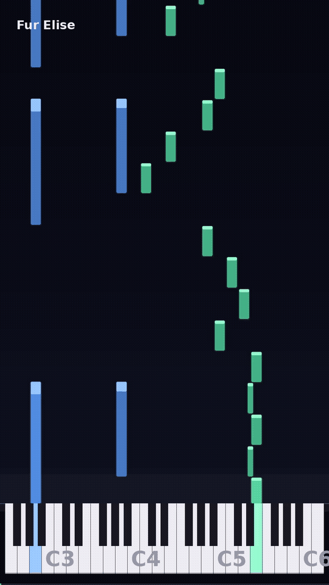

# notefall

Turn a MIDI file, or a recording of someone playing, into the falling notes video you see on YouTube and TikTok: dark background, piano along the bottom, blocks dropping onto the exact keys, left hand blue, right hand green.



```
pip install notefall
notefall song.mid -o song.mp4
```

That is it. No browser, no GUI, no project files. One CLI call, one mp4.

## Why

Existing falling notes tools are either a full DAW plugin, a paid app, or a web app that wants your video uploaded. This is a small Python package you can read in one sitting, render a three minute song in about two minutes, and script however you like.

## Install

```bash
# core (MIDI in, video out)
pip install notefall

# add audio to MIDI transcription, for recordings with no MIDI
pip install "notefall[transcribe]"
```

On Python 3.12 and newer, `basic-pitch` tries to pull a TensorFlow version that has no wheels. The runtime uses the ONNX model instead, so install it without its own deps:

```bash
pip install "notefall[transcribe]"
pip install basic-pitch --no-deps
```

Needs `ffmpeg` on your PATH.

```bash
sudo apt install ffmpeg
brew install ffmpeg
```

Python 3.9 and up. For transcription, 3.10 to 3.12 is the safe range, since `basic-pitch` depends on older numpy builds.

## Use

```bash
# MIDI straight to video, silent
notefall song.mid -o song.mp4

# MIDI plus a recording, keeps the real audio
notefall song.mid --audio recording.wav -o song.mp4 --title "Clair de Lune"

# MIDI and a piano preview track, when there is no recording
notefall song.mid --synth -o song.mp4

# a video or audio recording, no MIDI anywhere
notefall performance.mp4 -o falling.mp4

# landscape for desktop, other palette
notefall song.mid --size 1920x1080 --theme ocean -o song.mp4
```

### Recording in, no MIDI

Point it at the video or audio file and it pulls the audio, transcribes with [basic-pitch](https://github.com/spotify/basic-pitch), then renders:

```bash
notefall performance.mp4 -o falling.mp4 --keep-midi performance.mid
```

Be realistic about this path. On a clean digital piano it is close. On a pedaled acoustic piano it drops quiet notes and invents ghost ones. Tune it for the recording:

```bash
notefall performance.mp4 --onset-threshold 0.75 --min-note-ms 80 -o falling.mp4
```

Higher `--onset-threshold` means fewer ghosts. Lower `--min-note-ms` keeps short grace notes. Measured on a clean generated performance, onset 0.65 keeps 100% of real notes with 86% precision, and 0.75 keeps 100% with 96%. Soft playing needs the lower end. Save the MIDI with `--keep-midi`, fix it in any editor, then re-render from the fixed MIDI for a clean result.

If you have a digital piano, use its MIDI or USB export instead. It is exact, faster, and skips transcription entirely.

## Options

| flag | default | meaning |
| --- | --- | --- |
| `-o, --out` | `notefall.mp4` | output file |
| `--audio` | input audio | track to mux over the render |
| `--title` | none | text in the top left |
| `--size` | `1080x1920` | `WxH`, vertical by default |
| `--fps` | `30` | frame rate |
| `--lookahead` | `4.0` | seconds of notes visible above the keys |
| `--theme` | `default` | `default`, `sunset`, `ocean` |
| `--synth` | off | synthesise piano audio from the MIDI |
| `--no-progress` | off | hide the bottom progress bar |
| `--keep-midi` | none | save the transcribed MIDI |

## How it works

Three ideas, and the rest is drawing.

1. **Crop the keyboard to what is played.** 88 keys across 1080 px is 20 px per white key, which is unreadable on a phone. It keeps only the used pitch range plus four semitones, so blocks get two to four times wider.
2. **One geometry map.** A single `pitch -> (x0, x1, is_black)` dict feeds both the drawn keys and the x span of the falling blocks. They cannot drift apart.
3. **The block lands on the key line.** `bottom = kb_top - (start - t) * pps` with `pps = kb_top / lookahead`, and the height is the note duration times `pps`. A glow rectangle behind a block while it is being played, plus the matching key lighting up, is most of the perceived quality.

Frames are drawn with Pillow and piped as raw rgb24 straight into x264. No PNG per frame, no temp clutter.

## Development

```bash
git clone https://github.com/Suma-Udd/notefall
cd notefall
python3 -m venv .venv && source .venv/bin/activate
pip install -e ".[dev,transcribe]"
pytest
python3 examples/make_demo.py    # rebuild demo.mp4 from scratch
```

The demo is fully generated: `examples/make_demo.py` writes its own MIDI and audio, so there are no binary assets to trust.

## Roadmap

- [ ] sheet music staff view next to the roll
- [ ] SMPTE-accurate audio sync for long recordings
- [ ] note velocity mapped to colour intensity
- [ ] `--crop 48-84` manual keyboard range
- [ ] WebM and transparent background output
- [ ] MIDI from a `.musicxml` file

## License

MIT
