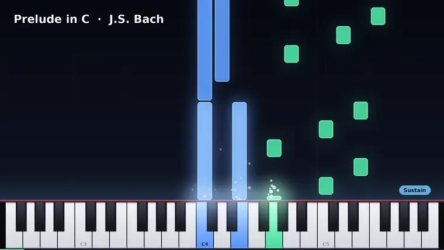
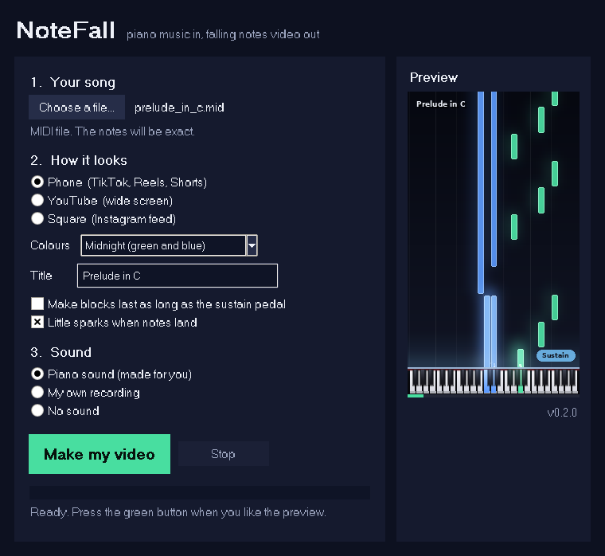

<p align="center">
  
</p>

<h1 align="center">NoteFall</h1>

<p align="center">
  <b>Turn piano music into those falling notes videos you see on YouTube and TikTok.</b><br>
  Give it a MIDI file or just a recording of someone playing. Get a video back.
</p>

<p align="center">
  <a href="https://github.com/Suma-Udd/notefall/releases/latest"></a>
</p>

<p align="center">
  <a href="https://github.com/Suma-Udd/notefall/actions/workflows/tests.yml"></a>
  
  
</p>

<p align="center">
  
</p>

<p align="center">
  🔊 <b>Watch it with sound:</b>
  <a href="media/demo-landscape.mp4">YouTube version</a> ·
  <a href="media/demo.mp4">phone version</a>
  <br><sub>Bach, Prelude in C, rendered by NoteFall with its built in piano sound. Nothing in that video was edited by hand.</sub>
</p>

---

## What it does

- 🎹 **MIDI in, video out.** Every note falls onto the exact key, left hand blue, right hand green. Exact timing, nothing to line up.
- 🎧 **No MIDI? No problem.** Drop in an mp3, a phone recording or a video of someone playing. NoteFall listens to it, writes down the notes, and keeps the real sound.
- 📱 **Ready to post.** Phone (TikTok, Reels, Shorts), YouTube or square. Five colour themes, a title, glow and little sparks when notes land.
- 🔊 **Never silent.** A MIDI with no recording gets a piano sound made for it, sustain pedal and all.
- 💻 **Works offline, on your own computer.** Nothing gets uploaded anywhere. No account, no watermark, free.

<p align="center">
  
</p>

## Get NoteFall

Pick whichever is easier for you. You don't need to know anything about Python or coding for either one.

### Option 1: download the app (easiest)

1. Go to the **[download page](https://github.com/Suma-Udd/notefall/releases/latest)**.
2. Grab the file for your computer:
   - **Windows:** `NoteFall-...-windows-x64.zip`
   - **Mac with Apple chip (M1, M2, M3...):** `NoteFall-...-mac-arm64.zip`
   - **Older Intel Mac:** `NoteFall-...-mac-x64.zip`
   - **Linux:** `NoteFall-...-linux-x64.tar.gz`
3. Unzip it and open **NoteFall**.

The first time you open it your computer might be suspicious, because the app isn't from a big company:

- **Windows** says "Windows protected your PC". Click **More info**, then **Run anyway**.
- **Mac** says it "can't be opened". Right-click (or Control-click) the app, pick **Open**, then **Open** again. You only do this once.

### Option 2: one line installer

This installs NoteFall properly (with a desktop shortcut) and you can run it again any time to update.

**Windows:** press the Windows key, type `PowerShell`, open it, paste this and press Enter:

```powershell
powershell -ExecutionPolicy ByPass -c "irm https://raw.githubusercontent.com/Suma-Udd/notefall/main/scripts/install.ps1 | iex"
```

**Mac or Linux:** open the **Terminal** app, paste this and press Enter:

```sh
curl -LsSf https://raw.githubusercontent.com/Suma-Udd/notefall/main/scripts/install.sh | sh
```

It sets up its own copy of Python in your user folder, so it won't mess with anything else on your computer, and it doesn't need an admin password.

## Make your first video

1. Open NoteFall.
2. Click **Choose a file...** and pick your song. Want to try it right away? Use [`examples/prelude_in_c.mid`](examples/prelude_in_c.mid) from this page.
3. Pick a shape (Phone, YouTube or Square) and some colours. The preview on the right updates as you go.
4. Type a title if you want one.
5. Click **Make my video**, choose where to save it, and wait. It usually takes about as long as the song itself.
6. Click **Play video**. That's it, post it wherever you like.

### Where do I get a MIDI file?

A MIDI file (`.mid`) is a list of which keys were pressed and when. It gives the cleanest result.

- **Digital piano or keyboard:** most can record straight to MIDI, over USB or onto a USB stick. Check for a "record" or "USB" button, or plug it into your computer and record with a free app like [MuseScore](https://musescore.org) or GarageBand.
- **Sheet music apps:** MuseScore, Flat and Noteflight can all export MIDI.
- **The internet:** search for the song name plus "MIDI". Lots of classical pieces are free and public domain.

No MIDI at all? Use a recording instead (see below).

### Using a recording instead

Pick an audio or video file (mp3, wav, m4a, mp4, mov and more) and NoteFall will figure out the notes on its own. It uses [Basic Pitch](https://basicpitch.spotify.com/) by Spotify, running right on your computer.

Be realistic about this part. On a clean recording of a digital piano it's really good. On an acoustic piano with lots of pedal, or with singing or other instruments in the background, it'll miss some quiet notes and invent a few that weren't there. For the best result, record just the piano in a quiet room.

## About the sustain pedal

When you hold the sustain pedal, a note keeps ringing after you let go of the key. So how long should the falling block be?

- **By default the block is as long as the key was actually held.** That's what you'd copy if you're learning the piece from the video, and it keeps fast passages readable.
- **The sound always follows the pedal**, so notes ring out like they would on a real piano.
- **A little "Sustain" sign lights up** above the keys whenever the pedal is down, so you can see what the pedal is doing too.
- **Want blocks that last as long as the sound?** Tick "Make blocks last as long as the sustain pedal" in the app, or use `--sustain pedal` on the command line. If a key is played again while the pedal is down, the old block stops right there, like it does on a real piano.

Recordings don't carry pedal information, so for those the blocks simply follow how long each note actually sounds.

## Command line

Everything the app does also works from a terminal. Running `notefall` with nothing after it opens the app.

```bash
# MIDI straight to a video next to it (song-notefall.mp4), with piano sound
notefall song.mid

# YouTube shape, other colours, a title
notefall song.mid --format youtube --theme neon --title "Clair de Lune"

# a recording, no MIDI anywhere
notefall performance.mp4

# MIDI for the notes, your real recording for the sound
notefall song.mid --audio recording.wav

# blocks as long as the pedal holds them
notefall song.mid --sustain pedal
```

| option | what it does |
| --- | --- |
| `-o, --out FILE` | where to save it. Default: next to your song, called `name-notefall.mp4` |
| `--format` | `phone` (1080x1920, default), `youtube` (1920x1080) or `square` (1080x1080) |
| `--size WxH` | any exact size, like `1440x2560` |
| `--theme` | `default`, `sunset`, `ocean`, `neon`, `gold` |
| `--title TEXT` | text in the top left |
| `--audio FILE` | sound to use under the video |
| `--silent` | no sound at all |
| `--soundfont FILE.sf2` | use a real sampled piano for the sound (needs [FluidSynth](https://www.fluidsynth.org) installed) |
| `--sustain keys/pedal` | block length, see [the sustain pedal](#about-the-sustain-pedal) |
| `--split NOTE` | colour by pitch instead of by track, like `--split C4` |
| `--fps N` | frames per second, default 30 (try 60 for extra smooth) |
| `--lookahead SECONDS` | how much of the future you see above the keys |
| `--lead-in SECONDS` | wait before the first note lands |
| `--no-sparks`, `--no-bar-lines`, `--no-progress` | turn those bits off |
| `--keep-midi FILE` | save the notes NoteFall heard in a recording, so you can fix them in any MIDI editor and render again |
| `--onset-threshold`, `--min-note-ms` | recording tuning. Higher threshold = fewer made up notes, lower = catches soft notes |

Run `notefall --help` for the full list.

### Use it from Python

```python
from notefall import render_video, synth

synth("song.mid", "song.wav")
render_video("song.mid", "song.mp4", width=1920, height=1080, audio="song.wav",
             theme_name="ocean", title="My Song")
```

## Questions

**How long does it take?** Roughly as long as the song on a normal laptop, often less. It uses all your CPU cores.

**Why are the left and right hands the colours they are?** If the MIDI has two tracks (most piano MIDIs do), or tracks named something like "Left hand" / "Right hand", NoteFall uses those. Otherwise it guesses by pitch. You can force a split point with `--split C4`.

**The keyboard doesn't show all 88 keys.** On purpose. It only shows the range your song uses, so the keys are big enough to see on a phone.

**Do I need to install ffmpeg?** No, NoteFall brings its own. If you already have one installed it'll use yours.

**Something broke.** Please [open an issue](https://github.com/Suma-Udd/notefall/issues) and include the message you got. If it's a MIDI file problem, attaching the file helps a lot.

## How it works

A few ideas, and the rest is drawing.

1. **Crop the keyboard to what's played.** 88 keys across a phone screen is 20 px per key, which is unreadable. Showing only the used range makes blocks two to four times wider.
2. **One geometry map.** A single `pitch -> (x0, x1, is_black)` mapping feeds both the drawn keys and the falling blocks, so they can't drift apart.
3. **The block lands on the key line.** `bottom = keys_top - (start - t) * speed`, and the height is the note length times the same speed.
4. **Glow is cheap if you cheat.** It's drawn at quarter size, blurred, scaled up and screen blended on top.
5. **Frames go straight into the encoder.** Frames are drawn on several CPU cores and piped as raw pixels into x264. No PNG per frame, no temp folders full of images.
6. **No TensorFlow.** Listening to recordings uses the Basic Pitch model directly through onnxruntime (the model is only 230 KB and ships inside NoteFall), with the note decoding ported to plain numpy. It gives the exact same notes as the original library.

## Development

```bash
git clone https://github.com/Suma-Udd/notefall
cd notefall
python3 -m venv .venv && source .venv/bin/activate   # Windows: .venv\Scripts\activate
pip install -e ".[dev]"
pytest
python examples/make_demo.py      # rebuild the demo videos from scratch
python scripts/build_app.py       # build the double-click app for your OS (pip install pyinstaller first)
```

The demo is fully generated: `examples/make_demo.py` writes the MIDI itself and makes its own sound, so there are no mystery binary files.

Releases: push a tag like `v0.2.0` (or run the **release** workflow from the Actions tab and type a tag) and GitHub Actions builds the Windows, Mac and Linux apps and puts them on the [releases page](https://github.com/Suma-Udd/notefall/releases).

## Ideas for later

- [ ] sheet music next to the falling notes
- [ ] a "learning mode" with note names on the blocks
- [ ] transparent background output for video editors
- [ ] MusicXML input
- [ ] live mode with a MIDI keyboard plugged in

## Credits

- Recording to notes: [Basic Pitch](https://github.com/spotify/basic-pitch) by Spotify, Apache 2.0. The model file and its license live in [`notefall/models`](notefall/models).
- MIDI reading: [pretty_midi](https://github.com/craffel/pretty-midi). Video: [FFmpeg](https://ffmpeg.org) via [imageio-ffmpeg](https://github.com/imageio/imageio-ffmpeg).

## License

MIT, see [LICENSE](LICENSE).
