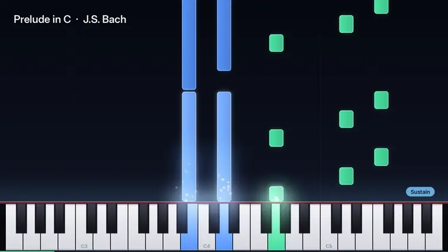
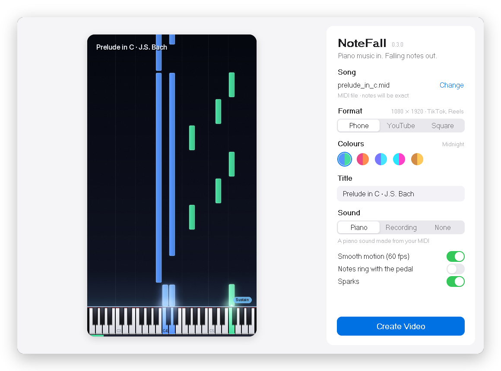

<p align="center">
  
</p>

<h1 align="center">NoteFall</h1>

<p align="center">
  Turn piano music into a falling notes video.<br>
  Give it a MIDI file or just a recording of someone playing. Get a video back.
</p>

<p align="center">
  <a href="https://github.com/Suma-Udd/notefall/releases/latest"><b>Download for Windows, Mac or Linux</b></a>
</p>

<p align="center">
  
</p>

<p align="center">
  <sub>Watch with sound: <a href="docs/media/demo-landscape.mp4">YouTube shape</a> · <a href="docs/media/demo.mp4">phone shape</a>. Bach's Prelude in C, straight out of NoteFall, nothing edited by hand.</sub>
</p>

<p align="center">
  <a href="https://github.com/Suma-Udd/notefall/actions/workflows/tests.yml"></a>
  
  
</p>

## What it does

- **MIDI in, video out.** Every note lands on the exact key, left hand in one colour, right hand in another.
- **No MIDI? Use a recording.** An mp3, a phone recording or a video of someone playing. NoteFall listens, writes down the notes and keeps the real sound.
- **Ready to post.** Phone (TikTok, Reels, Shorts), YouTube or square, in 60 fps.
- **Never silent.** A MIDI on its own gets a piano sound made for it, sustain pedal and all.
- **Private and free.** Runs on your own computer. No account, no upload, no watermark.

<p align="center">
  
</p>

## Get it

1. Open the **[download page](https://github.com/Suma-Udd/notefall/releases/latest)** and grab the file for your computer:

   | your computer | file |
   | --- | --- |
   | Windows | `NoteFall-…-windows-x64.zip` |
   | Mac with an Apple chip (M1 and newer) | `NoteFall-…-mac-arm64.zip` |
   | Older Intel Mac | `NoteFall-…-mac-x64.zip` |
   | Linux | `NoteFall-…-linux-x64.tar.gz` |

2. Unzip it and open **NoteFall**.

The first time, your computer might not trust it yet because it isn't from a big company. On **Windows** click **More info**, then **Run anyway**. On a **Mac** right-click the app, pick **Open**, then **Open** again. You only do this once.

<details>
<summary>Prefer a one line installer?</summary>

It installs NoteFall with a shortcut, needs no admin password, and you can run it again any time to update.

**Windows:** open **PowerShell**, paste this and press Enter:

```powershell
powershell -ExecutionPolicy ByPass -c "irm https://raw.githubusercontent.com/Suma-Udd/notefall/main/scripts/install.ps1 | iex"
```

**Mac or Linux:** open **Terminal**, paste this and press Enter:

```sh
curl -LsSf https://raw.githubusercontent.com/Suma-Udd/notefall/main/scripts/install.sh | sh
```

</details>

## Make a video

1. Open NoteFall and click **Choose…**. To try it right away, use [`examples/prelude_in_c.mid`](examples/prelude_in_c.mid).
2. Pick a format and colours. The preview moves as you change things.
3. Click **Create Video** and pick where to save it.
4. When it's done, click **Play**. That's it.

Want to know more? The **[guide](docs/guide.md)** covers where to find MIDI files, using recordings, the sustain pedal and common questions.

## More

| | |
| --- | --- |
| [Guide](docs/guide.md) | MIDI files, recordings, the sustain pedal, questions |
| [Command line](docs/command-line.md) | every option, and using NoteFall from Python |
| [How it works](docs/how-it-works.md) | how the video gets drawn, and why it's fast |
| [Contributing](CONTRIBUTING.md) | run it from source, tests, building the apps |
| [Changelog](CHANGELOG.md) | what changed in each version |

## Credits

Recording to notes uses [Basic Pitch](https://github.com/spotify/basic-pitch) by Spotify (Apache 2.0). Text is set in [Inter](https://rsms.me/inter/) (OFL). MIDI reading by [pretty_midi](https://github.com/craffel/pretty-midi), video by [FFmpeg](https://ffmpeg.org). The Basic Pitch and Inter licenses live in [`notefall/assets`](notefall/assets).

NoteFall itself is MIT licensed, see [LICENSE](LICENSE).
